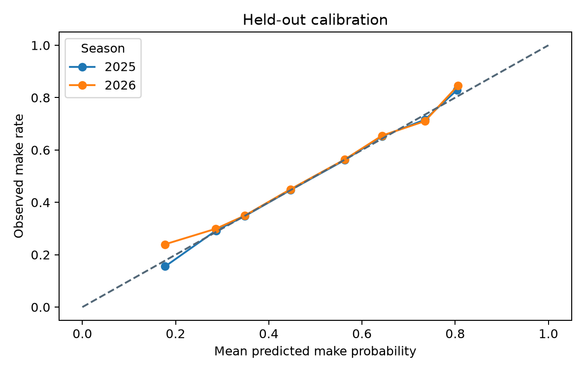
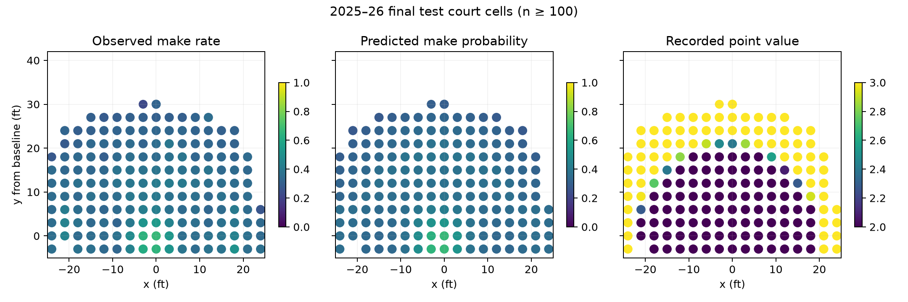

NCAA Division I Men's
Shot Selection

Probability estimation, expected points and constrained shot-mix scenarios
Academic report and portfolio research edition | September 2026

### Research question

For recorded NCAA Division I men's field-goal attempts, how does estimated make probability vary across court regions, and how much could a modest change in a team's shot mix change model-estimated points per recorded attempt?

### Abstract

This reproducible study evaluates 2,329,277 reconciled shot attempts across four seasons. A spatial logistic model with strictly prior-day player history was selected on 2025 and evaluated once on 2026. The scenario engine estimates a conditional change of 2.76 points per 100 recorded attempts for the prespecified case study.

### Main findings

The frozen model selected on 2024-25 was **Spatial + player history**; its 2025-26 Brier score and log loss are shown in the held-out table.

For Ohio State Buckeyes (2026), the constrained descriptive scenario estimates 2.76 points per 100 recorded attempts, with a game-bootstrap range [1.56, 4.06].

These values describe recorded attempts and do not identify a causal coaching intervention.

### Interpretation

This study evaluates predictions and conditional shot-mix scenarios. The outcome is points per recorded field-goal attempt. It excludes offensive possessions that end before a shot and does not establish the scoring effect of changing a real team's strategy.

Frozen analysis identifier: **ncaa-586d483b1c-374f8136**. All counts, scores and scenario values in this report come from this analysis run. The source blueprint supplied by the user motivates the project [1].

## 1. Data provenance and study population

Native NCAA shot-chart releases were joined to the matching ESPN team box-score release. A game entered the cohort only when both teams were present and the native counts reconciled to field-goal and three-point totals. Exact duplicate rows were retained because the source has no event identifier.

| Season ending | Source attempts | Included attempts | Games | D1 teams |
| --- | --- | --- | --- | --- |
| 2023 | 536,021 | 536,021 | 4,686 | 359 |
| 2024 | 579,312 | 579,312 | 4,967 | 358 |
| 2025 | 599,333 | 599,333 | 5,169 | 361 |
| 2026 | 614,611 | 614,611 | 5,276 | 365 |

Included rows are the reconciled analysis cohort; team counts are unique mapped team identifiers.

### Cohort construction

The final cohort is Division I men versus men coverage inferred from mutually consistent team-game records, with season-specific identities and game dates attached from the box-score crosswalk.

A native point value and zone are geometry-inferred by the upstream adapter. They are retained as recorded fields and described as such.

### Coverage and reconciliation

Coverage is not a claim that every NCAA Division I attempt is present. Reconciliation makes the included cohort auditable and excludes unmatched games.

The source is public SportsDataverse data; downstream redistribution rights remain governed by its upstream terms.

Season identifiers refer to the year in which the season ends. Counts describe the available, included source sample rather than a claim that every Division I attempt appears in the release.

## 2. Variables and spatial interpretation

| Field | Meaning and role |
| --- | --- |
| shot_x, shot_y, dist_ft | Native chart coordinates and Euclidean distance. |
| shot_zone | Upstream geometry-derived five-zone label. |
| made | Binary field-goal outcome. |
| point_value | Geometry-derived two- or three-point value. |
| player_key | Mapped player identifier; season history resets. |
| model_p | Selected model probability. |
| contest_id | Game identifier used for grouped resampling. |

### Coordinates and source zones

The source chart uses a baseline-relative coordinate convention. Cells in the evidence map are 3-foot bins and display only cells with at least 100 attempts; no spatial smoothing is applied. The 'paint' label means the upstream distance band, not a validated painted-key boundary.

### Available information

The core source does not supply per-shot defender distance, shot-clock time or a consistent catch-and-shoot label. Those variables do not enter the model. Source field-goal values determine whether a made shot is worth two or three points. No outcome text or future aggregate enters a predictor.

## 3. Study design and statistical methods

| Role | Seasons | Use |
| --- | --- | --- |
| Training | 2022-23, 2023-24 | Fit candidate models and priors |
| Selection | 2024-25 | Select by log loss; no final-test refit |
| Final test | 2025-26 | One fixed evaluation after selection |

No final-test outcome was used to choose the model or scenario settings.

### Model ladder

Global and zone-shrinkage baselines use training outcomes with a fixed 30-attempt prior. Spatial logistic candidates use a five-knot distance spline, absolute shot angle, zone indicators and L2 logistic regression.

The selected history model adds a 30-attempt player-zone prior and log prior attempts. Its history is updated only with earlier dates within a season, so current and future outcomes cannot enter the current prediction.

### Evaluation

The Brier score is the mean squared difference between predicted make probability and the binary outcome. Log loss penalizes confident errors more strongly. Lower values indicate better predictive performance. Reliability bins compare average prediction with observed make rate. A lower Brier score alone does not prove better calibration [4].

### Uncertainty

Metrics use 500 game-cluster bootstrap resamples. Scenario rates use 500 game resamples and 30-attempt shrinkage; intervals are conditional on the fixed selected mix.

### Prespecified hypotheses

| ID | Hypothesis | Held-out result | Status |
| --- | --- | --- | --- |
| H1 | Predicted make probability decreases as distance increases. | Spearman rho = -0.950 across 9 bands. | Supported |
| H2 | A lower-probability three-point zone can have higher expected value than a two-point zone. | Corner three: 36.0% predicted FG and 1.079 EP; paint: 41.9% predicted FG and 0.838 EP. | Supported |
| H3 | Raw zone rates move toward pooled estimates after shrinkage. | Largest change: mid, 41.3% raw to 40.2% shrunk. | Supported |
| H4 | Spatial and prior player history improve held-out probability prediction over a zone baseline. | Selected model improved Brier by 0.0019 and log loss by 0.0039. | Supported |

## 4. Held-out predictive results

Scores below are computed on the final 2025-26 test season after model selection was frozen.

| Model | Brier score | Log loss |
| --- | --- | --- |
| Global rate | 0.2472 | 0.6876 |
| Zone shrinkage | 0.2320 | 0.6567 |
| Spatial logistic | 0.2306 | 0.6537 |
| Spatial + player history | 0.2302 | 0.6528 |

Reliability bins compare mean predicted make probability with observed make rate.

Calibration is a diagnostic, not a guarantee. The selected probabilities describe recorded field-goal attempts under the available covariates.

### Coefficient interpretation

The nonlinear distance spline is interpreted through the held-out distance profile rather than as one linear odds ratio. The standardized terms below show multiplicative changes in odds for one standard deviation, holding the other transformed inputs fixed. They are associations, not causal effects.

**Shot angle (1 SD)**. Beta -0.054; odds multiplier 0.947. Association for a one-standard-deviation increase in absolute angle, holding transformed model inputs fixed.

**Prior player-zone make tendency (1 SD)**. Beta 0.188; odds multiplier 1.207. Association for stronger strictly prior-day player-zone history.

**Prior player-zone sample size (1 SD)**. Beta 0.040; odds multiplier 1.040. Association for a larger log prior-attempt count after controlling for the prior make tendency.

## 5. Frequency, make probability and expected points

For a shot with point value V and make probability p, expected points per attempt equal V multiplied by p. A three-point attempt can therefore have lower make probability and still have higher expected value than a two-point attempt. The comparison requires the same population and a probability estimate appropriate to its context.

Three-foot chart cells in the final test: observed rate, model probability and recorded point value; sparse cells omitted.

| Zone | Attempts | Raw FG% | Shrunk FG% | Shrunk EP |
| --- | --- | --- | --- | --- |
| rim | 450 | 69.8% | 69.4% | 1.388 |
| paint | 540 | 51.9% | 51.3% | 1.026 |
| mid | 92 | 41.3% | 40.2% | 0.805 |
| corner3 | 121 | 35.5% | 35.6% | 1.069 |
| abovebreak3 | 598 | 34.6% | 34.6% | 1.037 |

The case-study table shows raw and 30-attempt-prior zone rates together. Point value is geometry-inferred and aggregate-reconciled, not shot-tracking truth.

Expected points exclude free throws, offensive rebounds, turnovers before an attempt and the value of passing or driving instead. The maps therefore describe shot outcomes conditional on recorded attempts, not the full value of an offensive possession.

## 6. Constrained scenario analysis

The prespecified Ohio State Buckeyes case study uses 1,801 final-test attempts across 32 games. Zone make rates shrink toward training priors with 30 pseudo-attempts.

### Objective and constraints

Let q(z) be the proposed fraction of attempts from zone z, q0(z) the observed fraction and EP(z) its estimated expected points. The linear program maximizes the sum of q(z) multiplied by EP(z), or the corresponding conservative values, subject to the constraints below. SciPy's linear-programming solver evaluates this finite optimization problem [5].

| Constraint | Default setting and interpretation |
| --- | --- |
| Per-zone movement | At most +/-5 percentage points |
| Total movement | L1 budget 0.20 (10 points can move) |
| Three-point share | At most 60% |
| Sparse support | Zones below 30 attempts or five games stay fixed |

| Zone | Current | Scenario | Change |
| --- | --- | --- | --- |
| rim | 25.0% | 30.0% | 5.0% |
| paint | 30.0% | 30.0% | -0.0% |
| mid | 5.1% | 0.1% | -5.0% |
| corner3 | 6.7% | 1.7% | -5.0% |
| abovebreak3 | 33.2% | 38.2% | 5.0% |

The solution is feasible under all stated constraints. Its modeled change is 2.76 points per 100 attempts, with a conditional bootstrap interval of [1.56, 4.06].

The allocation is feasible under the stated mathematical constraints. Historical frequencies and analyst-selected bounds are only proxies for availability. The data do not establish that the extra attempts can actually be created at the same quality.

## 7. Robustness and sensitivity

The movement cap and risk penalty are varied while keeping the case study, priors and game bootstrap fixed.

| Scenario setting | Modeled gain / 100 attempts | Reassigned share |
| --- | --- | --- |
| 2.5% | 1.38 [0.78, 2.03] | Fixed risk = 1 |
| 5.0% | 2.76 [1.56, 4.06] | Fixed risk = 1 |
| 10.0% | 4.55 [3.13, 6.12] | Fixed risk = 1 |

The gain is sensitive to the amount of reassignment allowed and to the risk penalty; it should be treated as a planning diagnostic, not an intervention estimate.

### What the intervals cover

The displayed range resamples games and accounts for zone-rate sampling variation. It omits policy selection, opponent response, opportunity creation and model refitting.

### What the intervals omit

Resampling observed games does not reveal unobserved shot opportunities or opponents' strategic response. A narrow interval around a conditional scenario should not be interpreted as a narrow interval for an intervention's real-world effect. The fixed model and study design introduce additional uncertainty beyond the displayed resampling intervals.

## 8. Prospective validation readiness

The repository includes a frozen collection protocol, anonymous shot template and validation analyzer. A real strategy-effect result still requires new attempts collected after the model, zone definitions, shot distributions and metrics are frozen.

| Component | Prepared artifact |
| --- | --- |
| Coding rules | docs/CODING_GUIDE.md |
| Collection and analysis protocol | docs/PROSPECTIVE_VALIDATION_PROTOCOL.md |
| Anonymous data template | data/templates/prospective_shots_template.csv |
| Validation analyzer | scripts/analyze_prospective_validation.py |

The analyzer computes new-shot Brier score, log loss, calibration bins, observed points per attempt for each strategy, a session-cluster bootstrap interval and achieved zone shares. It refuses incomplete or invalid input rather than creating a result from missing evidence.

## 9. Conclusions, limitations and reproducibility

The finished product provides a reproducible NCAA Division I shot-selection workflow: reconciled cohort, chronological probability evaluation, conditional mix scenarios, a prospective validation package and an interactive explorer.

### Limits of the evidence

Filtered, reconciled NCAA Division I men versus men cohort; not complete NCAA coverage.

Native chart coordinates are discretized. Geometry and aggregate box checks do not establish shot-level tracking accuracy.

No defender distance, play context, shot clock or reliable period timing; predictions describe recorded locations and prior shooting history.

Online chronological evaluation: earlier test-date outcomes may update player histories; current and future outcomes are excluded.

Model probabilities are evaluated with calibration curves; no separate post-hoc calibration transform is applied.

Scenario uses 30-attempt shrinkage of selected-scope zone rates, separate from the predictive model; player suggestions with sparse zones are frozen.

Bootstrap ranges resample games and condition on a fixed chosen mix. They exclude policy selection and causal uncertainty.

A higher estimated scenario score is not evidence of improved game outcomes. Defensive response, possession changes and free throws are omitted.

Anonymous or abbreviated identities and partial reconciliation can introduce coverage bias; consult the data audit.

Public access and code licensing do not establish permission to redistribute the upstream sports data.

### Reproducible product

The repository contains the data audit, analysis code, saved model, final result JSON, static evidence figures and an interactive explorer. The report and slide deck read the frozen analysis output rather than introducing separately entered results. See the repository README for environment setup and the documented rebuild command.

The explorer supports comparing recorded shot distributions and conditional scenarios. The prospective package makes the next experiment reproducible, but no strategy-effect claim exists until valid post-freeze observations are collected and analyzed.

## References and source ledger

1. User-supplied basketball shot-selection blueprint (12-page PDF)..

2. SportsDataverse NCAA men's basketball shot releases and documentation.. <link href="https://github.com/sportsdataverse/hoopR/blob/main/R/load_ncaa_mbb.R" color="#087F8C">https://github.com/sportsdataverse/hoopR/blob/main/R/load_ncaa_mbb.R</link>

3. NCAA membership directory.. <link href="https://www.ncaa.org/about-us/membership-directory/" color="#087F8C">https://www.ncaa.org/about-us/membership-directory/</link>

4. Scikit-learn calibration documentation.. <link href="https://scikit-learn.org/stable/modules/calibration.html" color="#087F8C">https://scikit-learn.org/stable/modules/calibration.html</link>

5. SciPy linear programming documentation.. <link href="https://docs.scipy.org/doc/scipy/reference/generated/scipy.optimize.linprog.html" color="#087F8C">https://docs.scipy.org/doc/scipy/reference/generated/scipy.optimize.linprog.html</link>

### Data and software traceability

Run ncaa-586d483b1c-374f8136; data SHA-256 586d483b1c94707dd94d813f7167b9570efdd69894545f5af99671fc523f2d45; configuration SHA-256 374f8136f61a8eb8a606be96ed2a3b058096978b7aecaff810b61c60cb98d622. Rebuild with scripts/build_clean_table.py, scripts/run_analysis.py, scripts/build_report.py and scripts/build_presentation.mjs. Analyze new attempts with scripts/analyze_prospective_validation.py.

Access date for online references: 21 September 2026. This independent project uses public basketball data and makes no claim of university, NCAA or team affiliation. The supplied blueprint's institutional wording does not establish an affiliation for this analysis.

